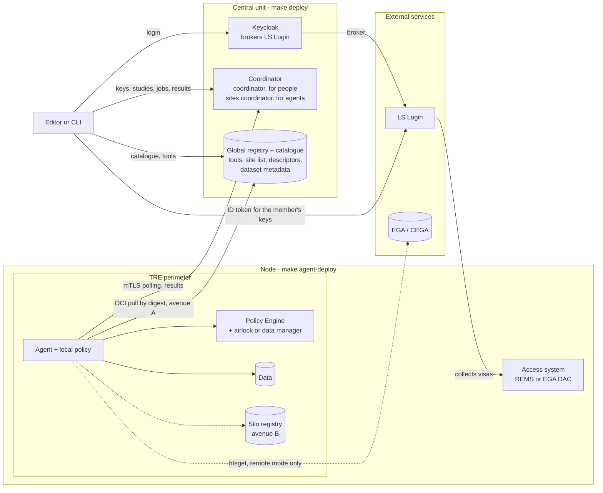
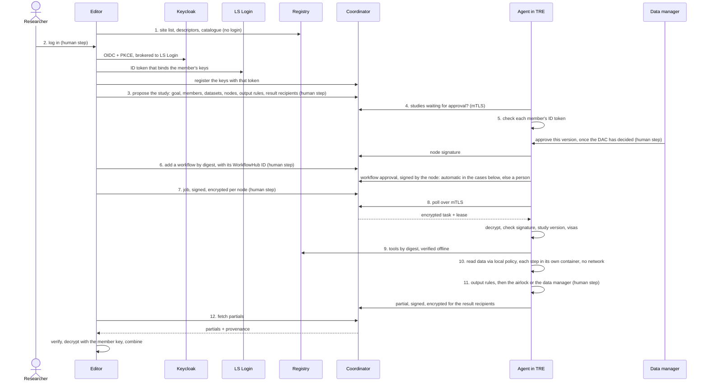

# Architecture

This doc covers the pieces of BioChef, who talks to whom, and how a federated run goes ([draw.io overview](diagrams/01-overview.drawio)). Where each piece runs is in [deploy.md](deploy.md), and how people and nodes log in is in [identity.md](identity.md).

## Pieces

| Piece | What it is | Runs |
|---|---|---|
| Editor | `biochef-app`: designs workflows, runs tools as WebAssembly, holds the member's keys, signs and encrypts jobs, combines results | Browser |
| Recipes | `biochef-recipes`: one `biochef.yaml` per tool, plus tiny tests | Git |
| Tools hub | `biochef-hub`: validates, builds, signs and publishes the recipes; also owns data types, node descriptors and silo information | GitHub Actions |
| Registry | One global OCI registry: tools, the signed catalogue, the site list, node descriptors, dataset metadata, synthetic datasets | The central server |
| Keycloak | Brokers LS Login, issues BioChef's tokens and keeps the login session | The central server |
| Coordinator | `biochef-coordinator`: studies, workflow approvals, jobs and results. It stores and delivers; it never reads a job or a result. Its state is in Postgres, so it can run as several instances | The central server |
| Agent | `biochef-agent`: runs workflows next to the data. Its page is where the data manager approves studies and workflows | Inside each node |
| Policy Engine | Checks every output against the study's output rules before it leaves the node | Inside each node |

## Principles

- The agent runs inside the node and opens every connection. Nothing connects into a TRE.
- Data never leaves a node. Only agent states (alive, running, waiting, error) and encrypted results do.
- Agents fetch tasks by polling the coordinator, in WES-request format.
- Each workflow step runs in a container of its own, with no network, only its own workspace and a clean environment: Podman, or Apptainer (or SingularityCE). The agent refuses to start with a runner that can't enforce this, and checks at start that a step has no network ([runner guarantees](https://github.com/ieeta-pt/biochef-agent/pull/106), section 14.1).
- Servers and TREs resolve every tool through the hub's signed catalogue and verify its signatures strictly and offline.
- Everyone logs in with LS Login (its test instance in `make up`); Keycloak sits in front of it.
- A member's keys are tied to their LS Login identity, and each node checks that before it approves a study ([identity.md](identity.md#tying-a-members-keys-to-them)).
- The coordinator and the global registry form one installable unit; the pilot runs one instance.

## Target

An arrow starts on the side that opens the connection, so no arrow enters the TRE.

Today the editor calls the agent directly (`/convert`, in `RecipePanel.js`). In the target below the editor talks only to the coordinator, the registry, Keycloak and LS Login, and never to an agent.

## A federated run

A run follows these steps ([draw.io](diagrams/08-federated-run.drawio)). The data manager approves in step 5 once the DAC has decided.

**Studies.** A study has a goal, members, datasets, nodes, output rules and result recipients, and each node approves it as a whole, version by version. It can name one node or several; there is no minimum. In step 5 the agent page checks each member's ID token against LS Login's keys, the editor as audience, and the member's LS AAI identifier as subject, before the data manager can approve ([identity.md](identity.md#tying-a-members-keys-to-them)).

**Result recipients.** Each study says, in `result_recipients`, who can read its results: the submitter only, or all members. The nodes approve that field with the rest of the study, and each partial is encrypted for those recipients.

**Workflows.** A study is approved first, with no workflows. Workflows join it later by digest, optionally with their WorkflowHub ID, and each node approves them. A node approves a workflow automatically, and signs that approval, only when its structure was already approved by hand in this study and the new values are within the recipe's limits. Otherwise a person decides. Approved workflows are kept, so a re-run under the same conditions needs no new approval.

**Outputs.** In step 11 the output rules are checked first, then the outputs go to the TRE's airlock or wait for the data manager to release them in the agent page. Only released outputs are encrypted, signed and sent.

## Terms

| Term | Meaning |
|---|---|
| Node / site / silo | An institution with data and a secure perimeter (a TRE, server, cluster or cloud tenant) that runs an agent |
| TRE | Trusted Research Environment |
| Data manager | The person at a node who approves studies and workflows; the DAC decides data access |
| Member | A researcher listed in a study, with a signing key and a result key tied to their LS Login identity |
| Study | Goal, members, datasets, nodes, output rules, result recipients and approved workflows. Each node approves it |
| Output rules | What a node may let out for a study, for example aggregates only and a minimum count |
| Result recipients | `result_recipients`: the submitter only, or all members |
| Job / task / run | A job is a member's signed, encrypted submission; a task is the part of a job for one node; a run is a task's execution in an agent |
| Partial | One node's result, signed by the node and encrypted for the study's result recipients |
| Node keys | An approval key, which signs the node's decisions and partials, and an encryption key, which jobs are encrypted for. Neither leaves the node |
| Site list | The signed list of nodes: each node's encryption key, approval key and certificate fingerprint, a version and an expiry, plus the history of LS Login's keys |
| Node descriptor | A node's description, read from the registry |
