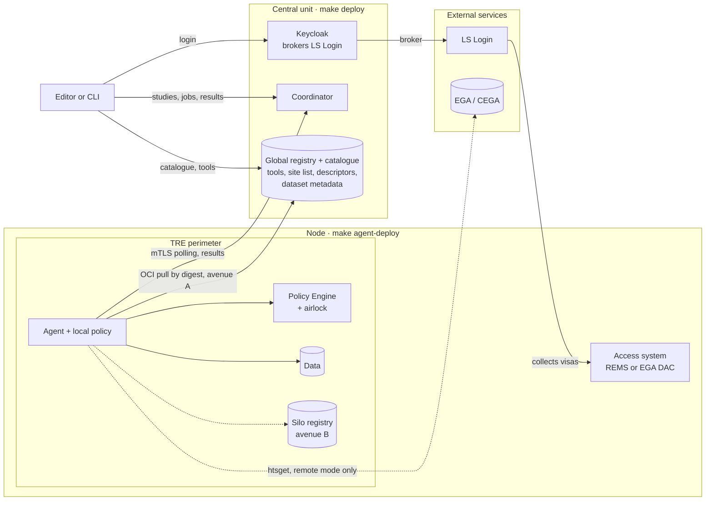
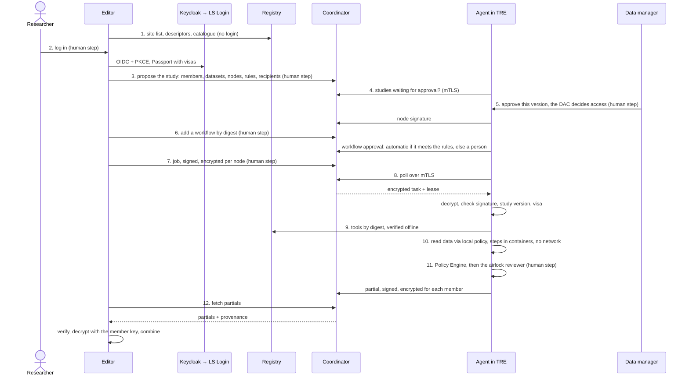

# Architecture

This doc covers the pieces of BioChef, who talks to whom, and how a federated run goes. Where each piece runs is in [deploy.md](deploy.md), and how people and nodes log in is in [identity.md](identity.md).

## Pieces

| Piece | What it is | Runs |
|---|---|---|
| Editor | `biochef-app`: designs workflows, runs tools as WebAssembly, signs and encrypts jobs, combines results | Browser |
| Recipes | `biochef-recipes`: one `biochef.yaml` per tool, plus tiny tests | Git |
| Tools hub | `biochef-hub`: validates, builds, signs and publishes the recipes; also owns data types, node descriptors and silo information | GitHub Actions |
| Registry | One global OCI registry: tools, the signed catalogue, the site list, node descriptors, dataset metadata, synthetic datasets | The central server |
| Keycloak | Logs researchers in through LS Login | The central server |
| Coordinator | `biochef-coordinator`: studies, workflow approvals, jobs and results. It stores and delivers; it never reads a job or a result | The central server |
| Agent | `biochef-agent`: runs workflows next to the data | Inside each node |
| Policy Engine | Checks every output before it leaves the node | Inside each node |

## Principles

- The agent runs inside the node and opens every connection. Nothing connects into a TRE.
- Data never leaves a node. Only agent states (alive, running, waiting, error) and encrypted results do.
- Agents fetch tasks by polling the coordinator, in WES-request format.
- Workflow steps run in Apptainer, with no network and a clean environment.
- Servers and TREs verify every tool's signatures strictly and offline.
- The coordinator and the global registry form one installable unit; the pilot runs one instance.

## Target

An arrow starts on the side that opens the connection, so no arrow enters the TRE.

## A federated run

A run follows these steps ([draw.io](diagrams/09-federated-run.drawio)). Choosing a dataset you can't access yet, in step 3, is the access request; the DAC decides in step 5.

A study is approved first, with no workflows. Workflows join it later by digest, and each node approves them. Approved workflows are kept, so a re-run under the same conditions needs no new approval.

## Terms

| Term | Meaning |
|---|---|
| Node / site / silo | An institution with data and a secure perimeter (a TRE, server, cluster or cloud tenant) that runs an agent |
| TRE | Trusted Research Environment |
| Data manager | The person at a node who approves studies and workflows; the DAC decides data access |
| Study | Members, datasets, nodes, approved workflows and how results combine. Each node approves it |
| Job / task / run | A job is a member's signed, encrypted submission; a task is the part of a job for one node; a run is a task's execution in an agent |
| Partial | One node's result, signed by the node and encrypted for each member |
| Site list | The signed list of nodes, their keys, the coordinator certificate and the editor release digests |
| Node descriptor | Signed by a node: the datasets it opens, the execution models it supports, the remote sources it allows |
