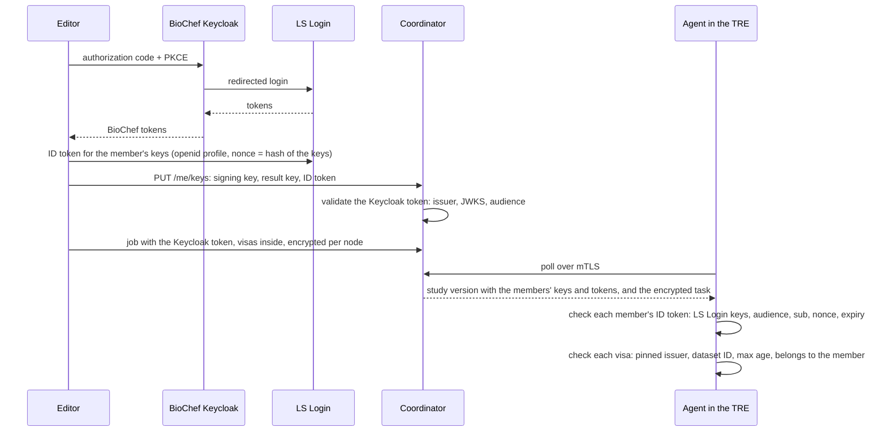

# Identity

This doc covers how people, their keys, nodes and data access are authenticated ([draw.io](diagrams/06-identity-keycloak.drawio)). BioChef runs its own Keycloak, which brokers LS Login, so researchers log in with LS Login.

## Who does what

| Service | Role |
|---|---|
| LS Login | The identity provider, always: every researcher logs in with it, in production and locally (its test instance). It issues the ID token that ties a member's keys to them, and the Passport with the visas |
| BioChef Keycloak | Sits in front of LS Login: brokers it as its only identity provider, issues BioChef's own tokens, which the coordinator trusts, and keeps the login session. It is never an identity provider itself |

## What needs an identity

| Actor | Talks to | How |
|---|---|---|
| Researcher | Editor → coordinator | LS Login, through BioChef's Keycloak |
| Member's keys | Editor → coordinator → each node | An LS Login ID token that names the member and binds their signing and result keys; each node checks it before approving a study |
| Node (agent) | Agent → coordinator | mTLS at `sites.coordinator.biochef.app`, with a per-site certificate from the federation PKI; the agent checks the coordinator's certificate against the federation CA |
| Data access | Agent → local data or CEGA/FEGA | GA4GH visas carried in the job, checked at the node; for EGA data, an EGA token carried encrypted in the job |
| Data manager | Approves studies and workflows in the agent page, inside the TRE | The TRE's own login; the node's approval key signs |
| CI | Tools hub → Sigstore, registry | GitHub OIDC and registry credentials |

Researchers never talk to the agent, and the registry needs no login. A person's login still matters in two places: between the editor and the coordinator, and at each node, which checks that a member's keys are theirs.

## Logging in

1. The editor starts an OIDC login (authorization code with PKCE) at BioChef's Keycloak.
2. Keycloak sends the researcher straight to LS Login: the `biochef` realm has LS Login as its only identity provider, and its browser flow uses the *Identity Provider Redirector*. Researchers never see a Keycloak form.
3. Keycloak issues the BioChef tokens.
4. The editor calls the coordinator with the Keycloak token; the coordinator validates issuer, JWKS and audience.
5. The visas travel inside the job, encrypted per node. Each node checks them itself.

## Tying a member's keys to them

A node trusts a job because it is signed with a member's key, so each node has to know the key is that member's.

1. When members register their signing and result keys with the coordinator (`PUT /me/keys`), the editor gets an ID token directly from LS Login, not through Keycloak. The editor is registered at LS Login as a public client and asks for the `openid profile` scopes, so the token carries the member's `name`.
2. The token's nonce binds both keys. The editor builds this object from the keys exactly as it sends them to `PUT /me/keys`: the signing key as a P-256 JWK with only `kty`, `crv`, `x` and `y` (`x` and `y` base64url, as in RFC 7518), and the result key as its age public key string:

   ```json
   {"result_key": "age1…", "signing_key": {"crv": "P-256", "kty": "EC", "x": "…", "y": "…"}}
   ```

   It serializes the object with RFC 8785 (JSON Canonicalization Scheme) to UTF-8 bytes, takes their SHA-256, and encodes the 32 bytes as base64url without padding, 43 characters. That string is the nonce.
3. The keys and the token travel with the member in every study version.
4. Before the data manager approves a study version, the agent page checks each member's token: its signature against LS Login's keys, its audience (the editor), its `sub` against the member's LS AAI identifier, its nonce against the hash of the keys listed for that member, and its expiry. An expired token is accepted only if it is signed with one of LS Login's keys in the site list's key history. The page then shows the token's `name`, so the data manager sees who they approve.
5. The signed site list keeps the history of LS Login's keys, so a node can still check a token after LS Login rotates its keys.



## Visas

Each node checks every visa in the job: its issuer, its dataset, its age, and that it belongs to the member. A visa belongs to the member when its `sub` is the member's LS AAI identifier, or is linked to it by a LinkedIdentities visa from a trusted issuer. Without that last check, any valid visa for the dataset would pass.

Nodes never use the Keycloak token as authorization; they rely on the members' ID tokens, the visas in the job and mTLS.

## Locally

`make up` logs in through LS Login's test instance, so the laptop needs to reach it. The local Keycloak brokers it exactly as production brokers LS Login. Only the URLs change between environments; the editor's code stays the same.

| Item | Detail |
|---|---|
| LS Login | Its test instance, with test accounts. Nobody logs in to Keycloak directly |
| Clients at LS Login | The local Keycloak (confidential, for the brokered login) and the editor (public, for the ID token that ties a member's keys), both with `*.biochef.localhost` redirects |
| Keycloak | `auth.biochef.localhost`, behind Caddy |
| Mode | `start-dev`, re-importing the realm on every start, so each run is identical |
| Realm | `biochef`: LS Login's test instance as its only identity provider, client `editor` (public, PKCE, redirect `https://biochef.localhost/*`), audience `coordinator`. No local users |
| Admin | `auth.biochef.localhost/admin`, loopback only |
| Issuer URLs | The browser and the coordinator must see the same Keycloak issuer, `https://auth.biochef.localhost/realms/biochef`. The agent checks members' ID tokens against the test instance's keys |

## Rules

- Validate tokens via OIDC discovery (issuer, JWKS, audience) against a configured list of trusted issuers.
- Identify people as `issuer#sub`.
- Keep authorization in BioChef data (studies, local policy), never in identity-provider claims. Visas are the exception: each node checks them for the datasets a job reads.
- Read visas through one adapter, with LS Login, REMS or a mock as its source.
