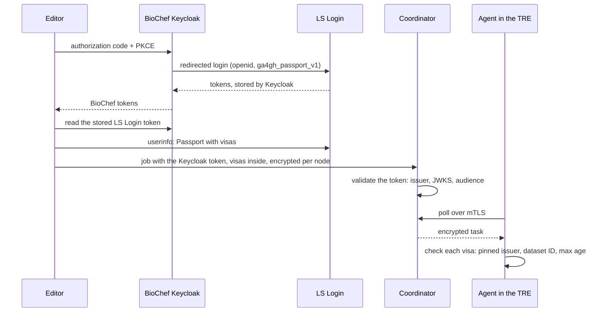

# Identity

This doc covers how people, nodes and data access are authenticated ([draw.io](diagrams/06-identity-keycloak.drawio)). BioChef runs its own Keycloak, which brokers LS Login, so researchers log in with LS Login.

## What needs an identity

| Actor | Talks to | How |
|---|---|---|
| Researcher | Editor → coordinator | LS Login, through BioChef's Keycloak |
| Node (agent) | Agent → coordinator | mTLS with a per-site certificate from the federation PKI; the coordinator's certificate is pinned in the agent |
| Data access | Agent → local data or CEGA/FEGA | GA4GH visas carried in the job, checked at the node; for EGA data, an EGA token carried encrypted in the job |
| Data manager | Approves studies and workflows in the agent page, inside the TRE | The TRE's own login; the node key signs |
| CI | Tools hub → Sigstore, registry | GitHub OIDC and registry credentials |

Researchers never talk to the agent, and the registry needs no login. So a person's login matters in one place only: **editor → coordinator**.

## Logging in

1. The editor starts an OIDC login (authorization code with PKCE) at BioChef's Keycloak.
2. Keycloak sends the researcher straight to LS Login: the `biochef` realm has LS Login as its only identity provider, and its browser flow uses the *Identity Provider Redirector*. Researchers never see a Keycloak form.
3. Keycloak issues the BioChef tokens and stores the LS Login token.
4. The editor reads the stored LS Login token and fetches the Passport with the researcher's visas.
5. The editor calls the coordinator with the Keycloak token; the coordinator validates issuer, JWKS and audience.
6. The visas travel inside the job, encrypted per node. Each node checks them itself.

Nodes never use the Keycloak token as authorization; they rely on the visas in the job and on mTLS.

## Locally

The Keycloak in `make up` stands in for LS Login, which can't run on a laptop. Only the issuer URL changes between environments; the editor's code stays the same.

| Item | Detail |
|---|---|
| Where | `auth.biochef.localhost`, behind Caddy |
| Mode | `start-dev`, re-importing the realm on every start, so each run is identical |
| Realm | `biochef`: client `editor` (public, PKCE, redirect `https://biochef.localhost/*`), audience `coordinator`, test users who log in at the Keycloak form |
| Admin | `auth.biochef.localhost/admin`, loopback only |
| Issuer URL | The browser and the coordinator must see the same issuer, `https://auth.biochef.localhost/realms/biochef` |

## Rules

- Validate tokens via OIDC discovery (issuer, JWKS, audience) against a configured list of trusted issuers.
- Identify people as `issuer#sub`.
- Keep authorization in BioChef data (studies, local policy), never in identity-provider claims.
- Read visas through one adapter, with LS Login, REMS or a mock as its source.
