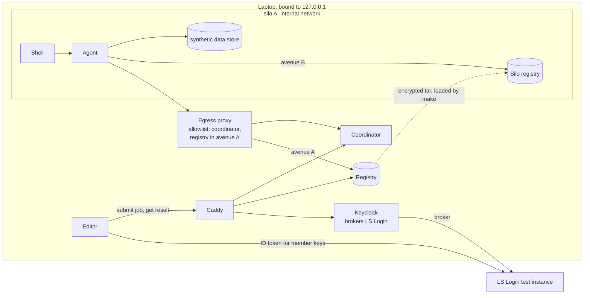

# Local Build

`make up` (= `make local`) runs the whole platform on a laptop, with simulated silos. It is the TRE we test on before the production TREs ([draw.io](diagrams/02-local-stack.drawio)). The servers it mirrors are in [deploy.md](deploy.md).

## What runs

| Part | Detail |
|---|---|
| Central pieces | Caddy, the editor dev server, Keycloak brokering LS Login's test instance, the coordinator, and a local global registry seeded from production. Each is reachable at `*.biochef.localhost`, bound to `127.0.0.1` |
| Outside the laptop | LS Login's test instance, where researchers log in with test accounts and the editor gets the ID token for a member's keys ([identity.md](identity.md#locally)); and the production registry, which seeds the local one |
| A silo | The agent, a synthetic data store and a silo registry, on an internal network. No route through Caddy and no published port. The silo's `.env` picks where the agent gets its tools: avenue A, the global registry, or avenue B, the silo registry ([deploy.md](deploy.md#registry)). The agent is built from `biochef-agent` ([agent.md](agent.md)) |
| Silo registry | Filled only from an encrypted tar, which a `make` step exports from the local global registry and loads into the silo. It never connects out. Locally both registries hold the same versions, because they come from the same seed; in a deployment they can differ |
| Egress | A proxy that lets a silo reach the coordinator, and the global registry only under avenue A |
| `make shell` | A shell inside the silo: the operator's way in |

It grows as pieces get built: first one silo with both registries, then the coordinator and login. More silos are added the same way, each with its own data, local policy and silo registry.

## How a silo talks

The editor never talks to the agent. Every arrow starts on the side that opens the connection, and none enters a silo.

| From → to | How |
|---|---|
| Editor → Keycloak | Login through Caddy (`auth.biochef.localhost`), OIDC with PKCE ([identity.md](identity.md#locally)) |
| Keycloak → LS Login test instance | Brokered login, as in production |
| Editor → LS Login test instance | The ID token that ties the member's keys to them |
| Editor → coordinator | HTTPS through Caddy (`coordinator.biochef.localhost`), with the login token: submit a job, fetch its result |
| Agent → coordinator | Through the egress proxy: poll, claim a task with a lease, upload the result |
| Agent → global registry (avenue A) | Through the egress proxy: tools by digest |
| Agent → silo registry (avenue B) | Inside the silo, with no egress: tools by digest |
| Global registry → silo registry | No connection: an encrypted tar, exported and loaded by `make` |
| Agent → data store | Inside the silo: the path local policy gives for a dataset ID |

**Data stays in the silo.** Each silo has a seeded synthetic data store. Jobs carry dataset IDs, and local policy maps each ID to a path. Nothing uploads data, from the editor or anywhere else.
