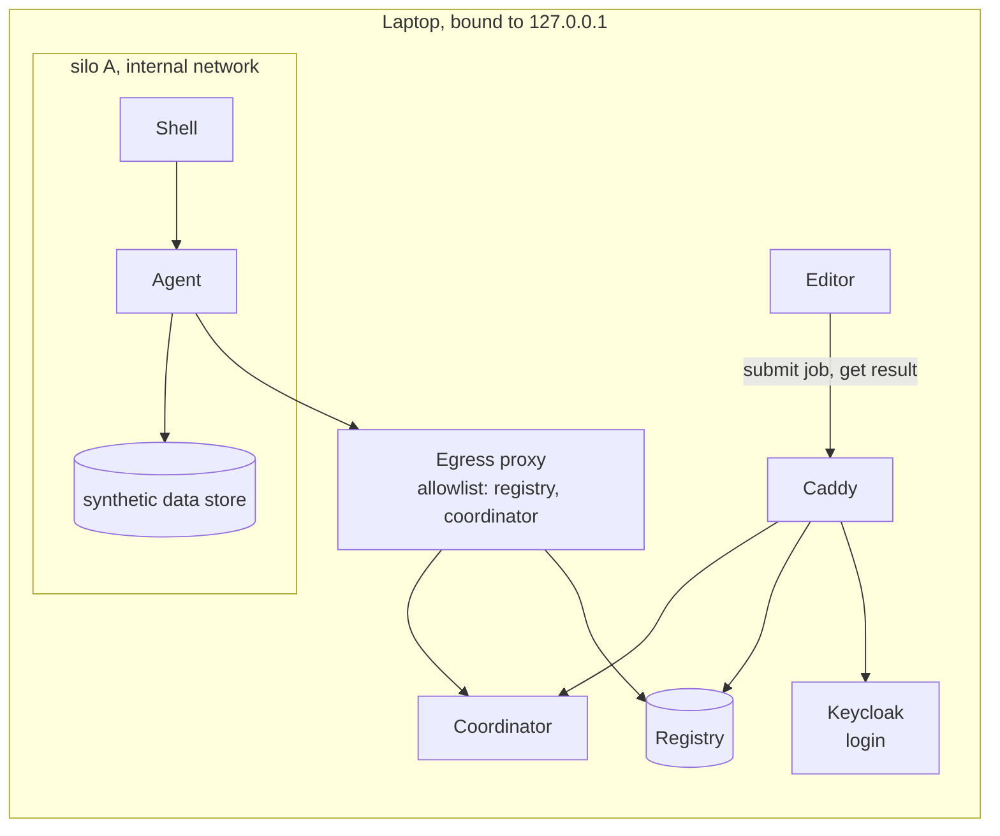

# Local Build

`make up` (= `make local`) runs the whole platform on a laptop, with simulated silos. It is the TRE we test on before the production TREs ([draw.io](diagrams/02-local-stack.drawio)). The servers it mirrors are in [deploy.md](deploy.md).

## What runs

| Part | Detail |
|---|---|
| Central pieces | Caddy, the editor dev server, Keycloak with test users, the coordinator, a local registry seeded from production. Each is reachable at `*.biochef.localhost`, bound to `127.0.0.1` |
| A silo | The agent and a synthetic data store on an internal network. No route through Caddy and no published port |
| Egress | A proxy that lets a silo reach only the registry and the coordinator |
| `make shell` | A shell inside the silo: the operator's way in |

It grows as pieces get built: first one silo, then the coordinator and login, then a second silo with its own registry (avenue B).

## How a silo talks

The editor never talks to the agent. Every arrow starts on the side that opens the connection, and none enters a silo.

| From → to | How |
|---|---|
| Editor → Keycloak | Login through Caddy (`auth.biochef.localhost`), OIDC with PKCE ([identity.md](identity.md#locally)) |
| Editor → coordinator | HTTPS through Caddy (`coordinator.biochef.localhost`), with the login token: submit a job, fetch its result |
| Agent → coordinator | Through the egress proxy: poll, claim a task with a lease, upload the result |
| Agent → registry | Through the egress proxy |
| Agent → data store | Inside the silo: the path local policy gives for a dataset ID |

**Data stays in the silo.** Each silo has a seeded synthetic data store. Jobs carry dataset IDs, and local policy maps each ID to a path. Nothing uploads data, from the editor or anywhere else.
